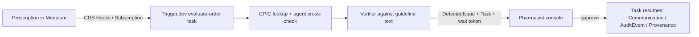

# Basepair

An always-on, EHR-embedded pharmacogenomics (PGx) safety service. It catches dangerous drug-gene mismatches at the moment of prescribing and holds them for a clinical pharmacist's one-click sign-off, with the exact published guideline citation.

Built for the **Built with Claude: Life Sciences** hackathon (Build track) with Claude Code and the Vercel AI SDK. For how Claude Code built it, including an autonomous refactor loop and a run where Claude dogfooded its own console, see [docs/CLAUDE_USAGE.md](./docs/CLAUDE_USAGE.md).

## The idea

Some drugs are useless or dangerous for patients with certain genetic variants (for example, clopidogrel does not work in CYP2C19 poor metabolizers). Health systems often have the genetic result on file, but nobody re-checks it when a drug is later prescribed, so preventable adverse events slip through. Basepair watches prescription events, cross-checks the patient's genetics against the published CPIC/DPWG guidelines, and surfaces a verified, cited alert to a pharmacist before the drug reaches the patient. The AI does not make clinical judgments; it parses messy inputs and verifies each alert against the guideline text, so the correctness bar is a published rule, not an opinion.

## Quick start

Production runs at [basepairrx.com](https://basepairrx.com). To run it locally:

```bash
bun install
cp .env.example .env.local   # fill in Medplum, Supabase, Better Auth, Trigger.dev, Anthropic
bun run db:migrate
bun scripts/seed-tenant.ts                                   # prints BASEPAIR_TENANT_ID
bun scripts/seed-user.ts <email> <password> <tenant-id>      # public sign-up is disabled
bun run dev           # Next.js console on http://localhost:3000
bun run trigger:dev   # Trigger.dev worker for the evaluate-order task
```

Upstash, Pinecone, and Mistral keys are optional; `.env.example` explains what each one turns on.

## How it works



## Features

- **Durable, approval-gated loop**: each prescription is evaluated in a Trigger.dev task that waits on a pharmacist's approval before writing back to Medplum.
- **Deterministic CPIC lookup**: the catalog covers 2,115 rules across 19 genes; the model cross-checks it but does not make the clinical call.
- **Cited verification**: every alert is graded against the matched CPIC rule's own guideline text.
- **Pharmacist console, audit view, and prescriber CDS card**: all live in the Next.js app.

## Status

The durable, approval-gated loop runs end to end against the Medplum hosted free tier: CDS Hooks/Subscription → `tasks.trigger` → Trigger.dev task (Medplum read → deterministic CPIC lookup + agent cross-check → verifier → write DetectedIssue/Task + wait token) → console approve → `wait.completeToken` → task resumes → Communication/AuditEvent/Provenance. The CPIC catalog covers **2,115 rules across 19 genes**, and the pharmacist console, audit view, and prescriber-facing CDS card are all live.

Honest scope: runs against a demo Medplum with synthetic patients (no PHI); multi-tenancy is structurally present but effectively single-tenant (RLS migration generated, not yet applied to a live DB); rate limiting is fail-open by design.

## Stack

Next.js 16, TypeScript, Bun, Drizzle, Supabase (app config + RLS), Better Auth (email/password console login), Trigger.dev (durable evaluation tasks + wait-token approvals), Upstash Redis (ratelimit / cache), Pinecone (guideline-prose retrieval for the verifier via integrated inference; optional, no-op when unset), shadcn/ui, oxlint. AI via the Vercel AI SDK (`ai@7`) and Claude through the direct `@ai-sdk/anthropic` provider. **EHR layer: Medplum** (FHIR datastore, SMART on FHIR auth, CDS Hooks trigger) — clinical data lives in Medplum as FHIR resources; the agentic evaluation runs as a durable Trigger.dev task. The verifier stays anchored on the matched CPIC rule's own `guidelineText` (retrieval only supplies the citation span, never the graded evidence).

## Development

```bash
bun run lint        # oxlint + eslint
bun run typecheck
bun run format
```

Other useful scripts: `db:generate` / `db:push` / `db:studio` (Drizzle), `db:cpic:load` (restore the pinned CPIC dump into a `cpic` schema), `pinecone:guidelines` (build the guideline retrieval index), and `trigger:deploy`. One-off seeding, evaluation, and setup scripts live in [`scripts/`](./scripts), for example `scripts/seed-medplum.ts` (synthetic patient) and `scripts/setup-order-trigger.ts` (Medplum Subscription and Bot).

## Data & attribution

The clinical logic is built on published, openly available pharmacogenomics resources: CPIC guidelines (the graded rules), PharmGKB, PharmCAT, and Synthea (synthetic patients), plus the LOINC, HGNC, and RxNorm code systems. Each is used under its own license and terms; no proprietary or patient data is included.

## License

[MIT](./LICENSE) © 2026 Tyler Gibbs.
