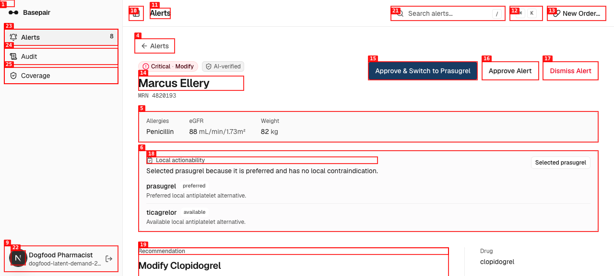
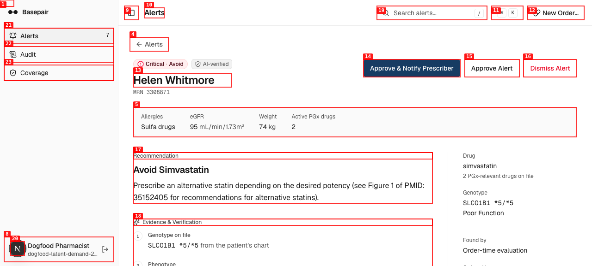
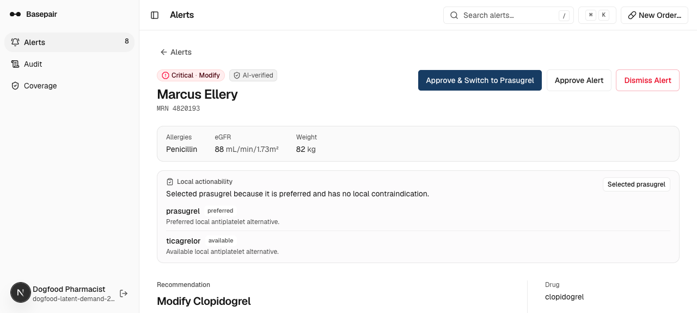
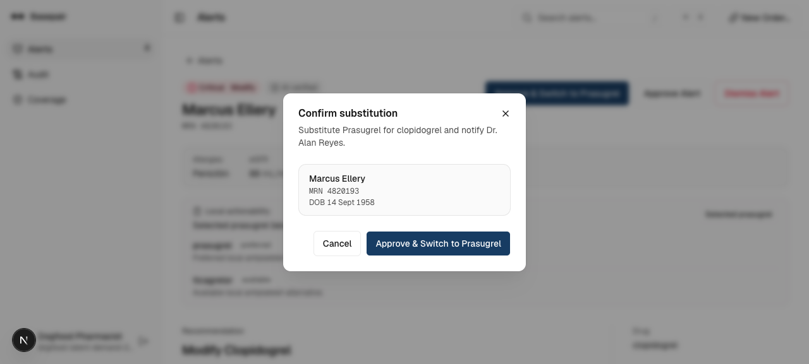
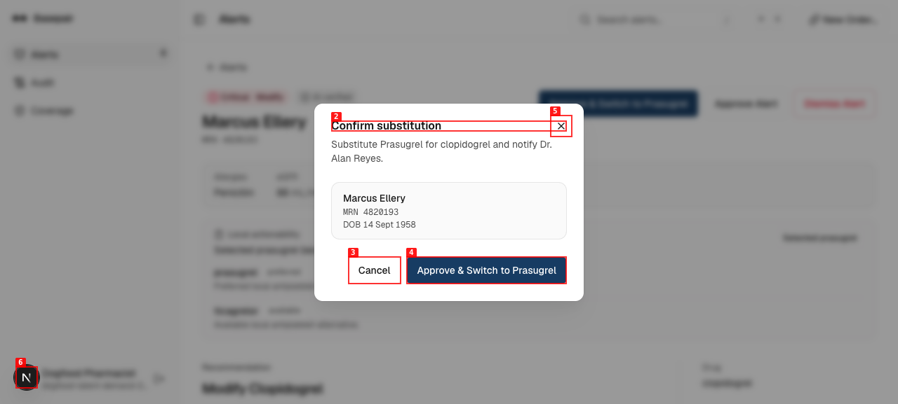
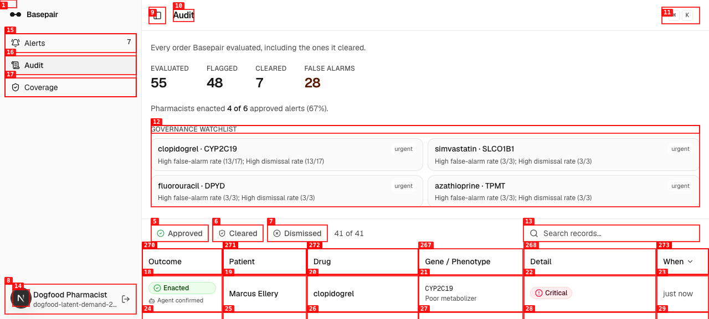
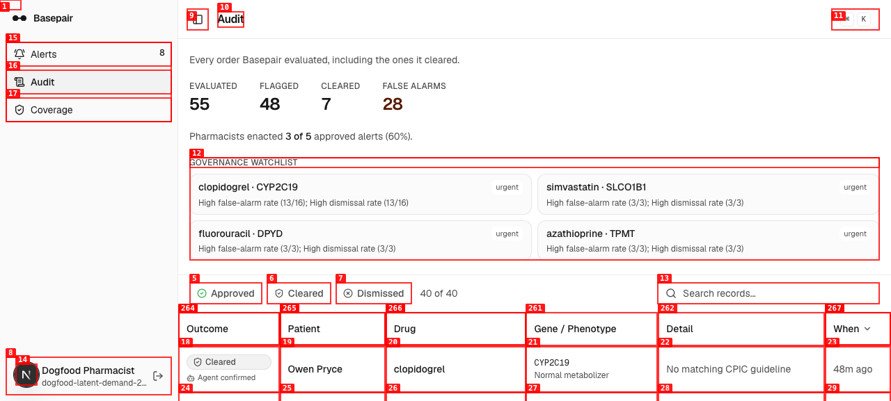
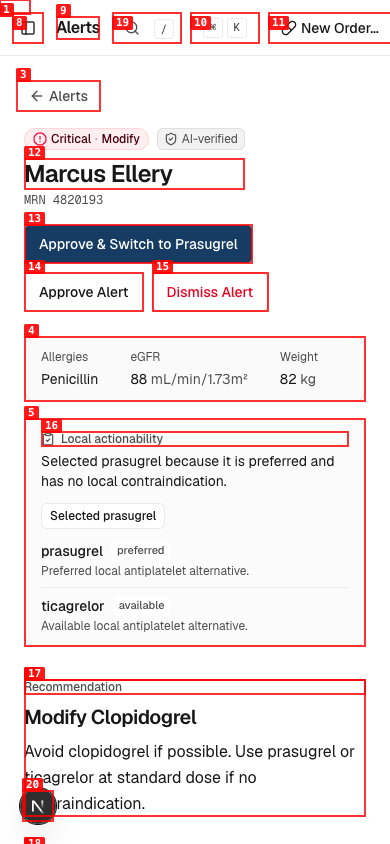

# Dogfood Report: Basepair Latent-Demand Features

| Field | Value |
|-------|-------|
| **Date** | 2026-07-09 |
| **App URL** | http://localhost:3000 |
| **Session** | basepair-latent-demand |
| **Scope** | Alert local actionability, phenotype concordance, and audit governance |

## Summary

| Severity | Count |
|----------|-------|
| Critical | 0 |
| High | 1 |
| Medium | 3 |
| Low | 2 |
| **Total** | **6** |

## Passed End-to-End Checks

- Authenticated through the real console login with a temporary synthetic pharmacist account; the account was deleted after testing.
- Opened the clopidogrel alert and confirmed local formulary ranking selected preferred prasugrel ahead of available ticagrelor.
- Confirmed the substitution through the real UI. The alert queue dropped from 8 to 7 and Audit added `Enacted · just now` for Marcus Ellery.
- Independently verified Trigger.dev run `run_cmrdrn8o875on0vocdk7wak0k` resumed from its approval waitpoint and completed at `2026-07-09T18:08:28Z` with phase `resolved` on deployment `20260709.2`.
- Loaded governance metrics and the noisy-rule watchlist from live audit data at desktop and 390x844 mobile viewports.
- Browser console and page-error checks found no application exceptions or failed requests in the tested workflows.
- Focused automated suite: 25 passed, 0 failed; TypeScript check passed.

## Issues

### ISSUE-001: Phenotype concordance has no observable product path

| Field | Value |
|-------|-------|
| **Severity** | high |
| **Category** | functional |
| **URL** | http://localhost:3000/alerts/595222b0-2376-4f13-b8fc-2d28924cf08c |
| **Repro Video** | N/A |

**Description**

Alert detail shows only the phenotype resolved from the CPIC allele-function table. There is no source/lab phenotype, concordance verdict, mismatch severity, or review flag, so a pharmacist cannot observe or act on the new concordance result end to end.

**Repro Steps**

1. Open the Marcus Ellery clopidogrel alert.
   

2. Inspect the phenotype evidence and the rest of the page.

3. **Observe:** only the derived phenotype is shown; no source-vs-derived comparison or concordance state is present.

---

### ISSUE-002: Simvastatin omits local alternatives

| Field | Value |
|-------|-------|
| **Severity** | medium |
| **Category** | functional |
| **URL** | http://localhost:3000/alerts/62ac5f3c-78de-4b07-a36b-9204fd375eb5 |
| **Repro Video** | N/A |

**Description**

The simvastatin alert recommends prescribing an alternative statin, but the local-actionability panel is absent. The pharmacist receives no preferred/available local alternatives and the primary action falls back to a generic prescriber notification.

**Repro Steps**

1. Open the Helen Whitmore simvastatin alert.
   

2. Read the recommendation to prescribe an alternative statin.

3. **Observe:** there is no local-actionability region between patient context and recommendation.

---

### ISSUE-003: Approval appears stuck during a long submit

| Field | Value |
|-------|-------|
| **Severity** | medium |
| **Category** | ux |
| **URL** | http://localhost:3000/alerts/595222b0-2376-4f13-b8fc-2d28924cf08c |
| **Repro Video** | videos/approve-local-action-confirm.webm |

**Description**

After confirming the prasugrel substitution, the dialog remains unchanged for roughly 7-10 seconds. The button has no pending label or progress indicator, making the action look dead and encouraging a duplicate click. The server action ultimately returned 200, removed the alert from the queue, and added an Enacted audit row.

**Repro Steps**

1. Open the substitution confirmation.
   

2. Click "Approve & Switch to Prasugrel."
   

3. **Observe:** the unchanged dialog is still visible after seven seconds.
   

4. Wait longer and open Audit; the action eventually appears as Enacted.
   

---

### ISSUE-004: Governance watchlist cannot govern or tune rules

| Field | Value |
|-------|-------|
| **Severity** | medium |
| **Category** | functional |
| **URL** | http://localhost:3000/audit |
| **Repro Video** | N/A |

**Description**

The watchlist identifies noisy drug-gene rules, but every item is static text. There is no route to inspect the rule's events, adjust thresholds, suppress a rule, require review, or record a governance decision, so the requested tuning workflow stops at detection.

**Repro Steps**

1. Open Audit and wait for the streamed audit data.
   

2. Inspect each urgent watchlist item.

3. **Observe:** none of the watchlist entries exposes an action or detail link.

---

### ISSUE-005: Mobile account control overlaps clinical content

| Field | Value |
|-------|-------|
| **Severity** | low |
| **Category** | visual |
| **URL** | http://localhost:3000/alerts/595222b0-2376-4f13-b8fc-2d28924cf08c |
| **Repro Video** | N/A |

**Description**

At 390x844, the fixed lower-left account control sits over the recommendation text while scrolling the alert detail.

**Repro Steps**

1. Set the viewport to 390x844 and open the Marcus Ellery alert.
   

2. **Observe:** the circular account control covers the lower-left recommendation copy.

---

### ISSUE-006: Audit contains duplicated drug text

| Field | Value |
|-------|-------|
| **Severity** | low |
| **Category** | content |
| **URL** | http://localhost:3000/audit |
| **Repro Video** | N/A |

**Description**

One cleared Marcus Ellery audit row renders the drug as `clopidogrelclopidogrel`, reducing trust in an audit surface that should preserve exact clinical provenance.

**Repro Steps**

1. Open Audit and wait for records to load.
   

2. Find the Marcus Ellery row marked "Cleared · Engine override."

3. **Observe:** the drug cell reads `clopidogrelclopidogrel`.
